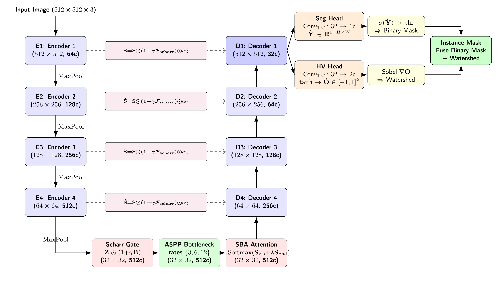
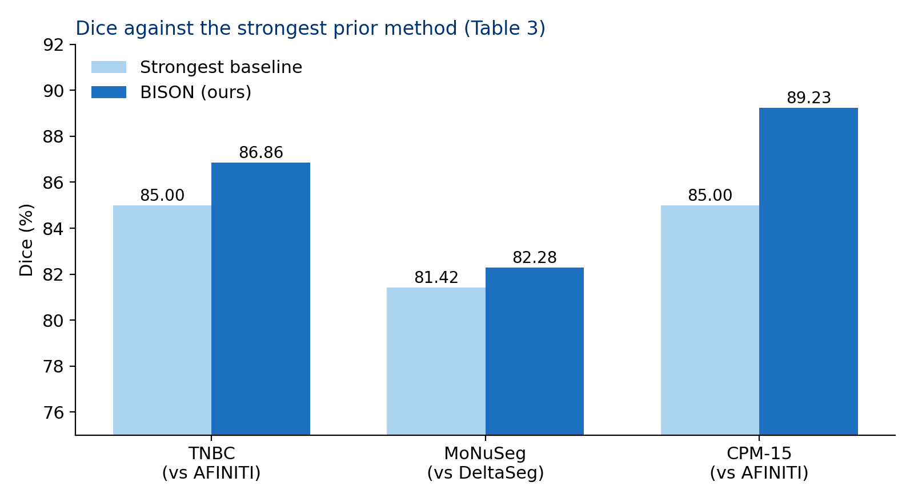
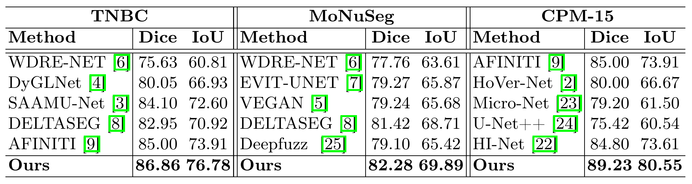
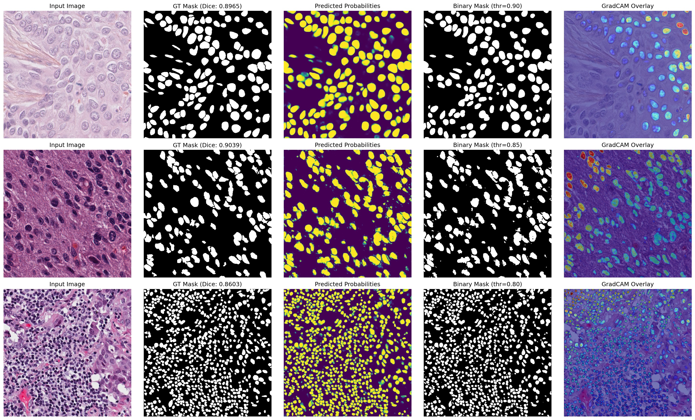
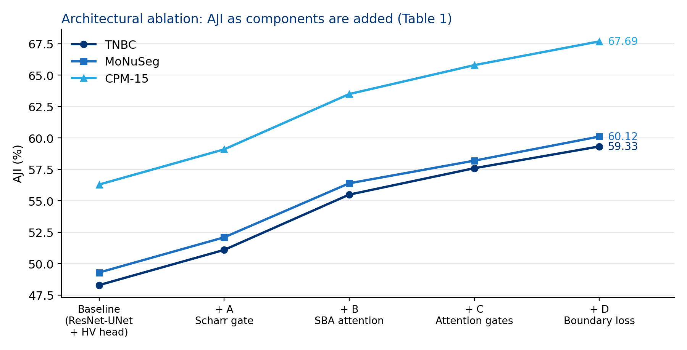
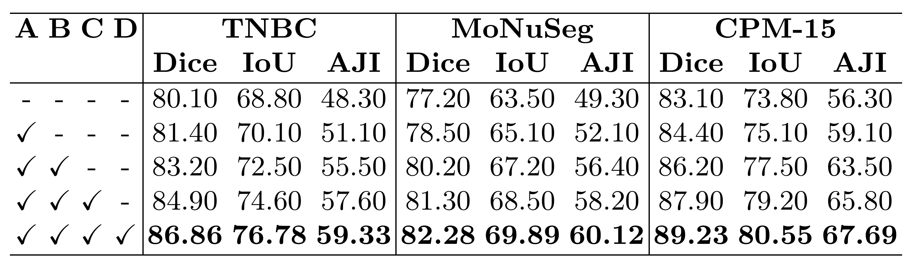
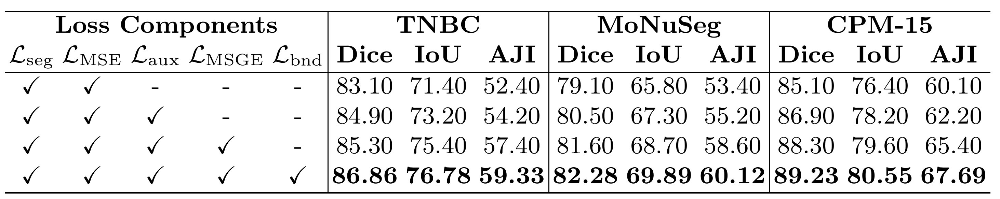

<div align="center">

# **BISON: Boundary-Injected Segmentation of Nuclei via Exact Softmax Attention**

### **7th International Conference on Medical Imaging and Computer-Aided Diagnosis (MICAD 2026)**
#### **Oral Presentation &bull; Paper ID: 740 &bull; Springer LNEE Series**

</div>

<p align="center">
  <a href="http://www.micad.org/"></a>
  <a href="http://www.micad.org/"></a>
  <a href="https://www.springer.com/series/7818"></a>
  <a href="LICENSE"></a>
  <a href="https://pytorch.org/"></a>
  <a href="https://www.python.org/"></a>
  <a href="https://github.com/mukut02/MICAD_unet"></a>
</p>

Official repository for **"BISON: Boundary-Injected Segmentation Of Nuclei via Exact Softmax Attention"**, accepted for **Oral Presentation** at the **[7th International Conference on Medical Imaging and Computer-Aided Diagnosis (MICAD 2026)](http://www.micad.org/)**, Edinburgh, United Kingdom, October 22–24, 2026. Published in Springer *Lecture Notes in Electrical Engineering (LNEE)*.

**Authors:** Mukut Chatterjee<sup>1,*</sup>, Diptarko Bhattacharjee<sup>1,*</sup>, Debatra Banerjee<sup>1,*</sup>, Dmitrii Kaplun<sup>2,3,✉</sup>, Asya Lyanova<sup>3</sup>, Ram Sarkar<sup>1</sup>  
<sup>1</sup> Department of Computer Science & Engineering, Jadavpur University, Kolkata, India  
<sup>2</sup> School of Computer Science and Technology / School of Artificial Intelligence, China University of Mining and Technology, Xuzhou, China  
<sup>3</sup> Intelligent Devices Institute, St. Petersburg Electrotechnical University "LETI", St. Petersburg, Russia  

<sup>*</sup> Equal contribution (co-first authors)  
<sup>✉</sup> Corresponding author: [dikaplun@etu.ru](mailto:dikaplun@etu.ru)  
**Conference Website:** [www.micad.org](http://www.micad.org/) | **Paper ID:** 740 | **Code:** [github.com/mukut02/MICAD_unet](https://github.com/mukut02/MICAD_unet)

---

## Overview

Accurate instance segmentation of cell nuclei in routine hematoxylin and eosin (H&E) histopathology images is foundational for cancer grading, sub-typing, and patient prognosis. In aggressive malignancies such as Triple-Negative Breast Cancer (TNBC), nuclei vary substantially in morphology and chromatin texture, form dense and overlapping clusters, and exhibit poor contrast against the surrounding stroma.

Standard encoder-decoder networks degrade high-frequency boundary information during spatial downsampling, leading to false merges between adjacent nuclei. Multi-task approaches like HoVer-Net mitigate this by predicting horizontal and vertical (HV) distance fields, yet their intermediate layers still struggle to retain sharp perimeter definitions.

**BISON** introduces a multi-task ResNet-UNet architecture that injects differential boundary priors throughout the network:
- **Scharr Pre-Bottleneck Gate:** Amplifies high-frequency spatial edge gradients before features undergo bottleneck compression.
- **Spatial Boundary-Aware (SBA) Attention:** Fuses visual self-attention with a non-learnable 6-channel geometric boundary fingerprint at the $32 \times 32$ bottleneck ($N = 1024$ tokens), preserving full pairwise quadratic attention without memory bottlenecking.
- **Actively Gated Skips & Dual Heads:** Refines skip connections via boundary and attention gates, while dual heads simultaneously estimate foreground probabilities and continuous HV distance maps for marker-controlled watershed post-processing.

---

## Model Architecture

<p align="center">
  
</p>

*Figure 1: Schematic of BISON. Features from encoder stages E1–E4 undergo Scharr gating and ASPP before entering the Spatial Boundary-Aware (SBA) attention module at the bottleneck. Two-stage gated skip connections route edge-enhanced representations into the decoder, feeding dual prediction heads for semantic segmentation and continuous HV offset estimation.*

### Structural Breakdown

| Stage | Spatial Size | Channels (Enc / Dec) | Description |
|:---|:---:|:---:|:---|
| **Input** | $512 \times 512$ | 3 | Normalized 3-channel H&E image tile |
| **Stage 1 (E1 / D1)** | $512 \times 512$ | 64 / 32 | Initial convolution and shallow boundary feature maps |
| **Stage 2 (E2 / D2)** | $256 \times 256$ | 128 / 64 | Intermediate spatial features; auxiliary loss supervised on D2 |
| **Stage 3 (E3 / D3)** | $128 \times 128$ | 256 / 128 | Mid-level semantic features; auxiliary loss supervised on D3 |
| **Stage 4 (E4 / D4)** | $64 \times 64$ | 512 / 256 | High-level contextual representations |
| **Bottleneck** | $32 \times 32$ | 512 | Scharr Gate $\rightarrow$ ASPP $\rightarrow$ Spatial Boundary-Aware (SBA) Attention |

---

## Quantitative Benchmarks

<p align="center">
  
</p>

BISON was evaluated on three public histopathology benchmarks: **TNBC** (Naylor et al., 2018), **MoNuSeg** (Kumar et al., 2019), and **CPM-15** (Kumar et al., 2017). Across all datasets, the model consistently outperforms prior published baselines in both semantic overlap and instance-level separation.

### Performance Summary (Dice / IoU / AJI in %)

| Dataset | Evaluation Metric | Prior State-of-the-Art | BISON (Ours) | Relative Margin |
|:---|:---:|:---:|:---:|:---:|
| **TNBC** | Dice / IoU / AJI | 85.00 / 73.91 / 48.30 *(AFINITI)* | **86.86 / 76.78 / 59.33** | **+1.86 / +2.87 / +11.03** |
| **MoNuSeg** | Dice / IoU / AJI | 81.42 / 68.71 / 49.30 *(DeltaSegment)* | **82.28 / 69.89 / 60.12** | **+0.86 / +1.18 / +10.82** |
| **CPM-15** | Dice / IoU / AJI | 85.00 / 73.91 / 56.30 *(AFINITI)* | **89.23 / 80.55 / 67.69** | **+4.23 / +6.64 / +11.39** |

<details>
<summary><b>View complete comparative baselines (Table 3 from proceedings)</b></summary>

<p align="center">
  
</p>

</details>

---

## Qualitative Visualizations

<p align="center">
  
</p>

*Figure 2: Visual segmentation outputs across representative test images. Columns (left to right): (1) Input H&E image, (2) Expert ground truth, (3) Predicted probability map $\hat{p}$, (4) Marker-controlled watershed instance segmentation, and (5) Grad-CAM visual attention overlays illustrating focus on cell membranes. Rows (top to bottom): TNBC (Dice: 0.8965), CPM-15 (Dice: 0.9039), and MoNuSeg (Dice: 0.8603).*

---

## Ablation Studies and Analysis

<p align="center">
  
</p>

Systematic component-wise ablations validate each architectural and objective design decision:

1. **SBA Attention Drives Instance Separation (+4.3 to +4.4 AJI):** Integrating the structural boundary descriptor $\Psi\Psi^\top$ prevents attention from diffusing across nuclear boundaries, leading to the single largest performance jump across all three datasets.
2. **Mean Squared Gradient Error (MSGE) Smooths Offset Fields (+3.2 to +3.4 AJI):** Penalizing the gradient discrepancy between predicted and ground-truth offset vectors directly suppresses artifacts on the topographic energy surface, significantly reducing instance over-segmentation and under-segmentation during watershed.
3. **Boundary Consistency Loss ($\mathcal{L}_{\text{bnd}}$):** Directly matches Scharr differential responses between predicted probability maps and ground-truth masks, delivering a consistent final boost in boundary fidelity.
4. **Backbone Evaluation:** A pre-activation ResNet-18 backbone proved optimal, outperforming lighter mobile networks (which compress high-frequency spatial cues too early) as well as deeper networks like ResNet-50 (which displayed diminishing returns on smaller histopathology cohorts).

<details>
<summary><b>View official ablation tables (Table 1 & Table 2 from proceedings)</b></summary>

| Architectural Ablation | Loss Formulation Ablation |
|:---:|:---:|
|  |  |

</details>

---

## Method Details

<details>
<summary><b>Mathematical formulation and inference pipeline</b></summary>

### 1. Spatial Boundary-Aware Attention
Visual query-key affinities and boundary structural descriptors are fused prior to softmax scaling:
$$S_{\text{vis}} = \frac{QK^\top}{\sqrt{d_k}}, \qquad S_{\text{bnd}} = \Psi\Psi^\top$$
$$A = \mathrm{Softmax}\left(S_{\text{vis}} + \lambda S_{\text{bnd}}\right)$$
where $\Psi \in \mathbb{R}^{N \times 6}$ is a non-learnable geometric descriptor capturing gradient magnitude, cross-scale orientation consistency, directional vectors $(r\cos 2\theta, \; r\sin 2\theta)$, Hessian polarity, and an isotropic blobness index.

### 2. Composite Training Objective
$$\mathcal{L}_{\text{total}} = \mathcal{L}_{\text{seg}} + \lambda_{hv}\mathcal{L}_{hv} + \lambda_{bnd}\mathcal{L}_{bnd}$$
- **Multi-Scale Segmentation Loss ($\mathcal{L}_{\text{seg}}$):** Evaluated at decoder stages D1, D2, and D3 using combined Focal Tversky and class-weighted Binary Cross-Entropy with positive weight capped by $\zeta$.
- **Instance Geometry Loss ($\mathcal{L}_{hv}$):** Combines mean squared error (MSE) on continuous centroid offsets $\hat{O} \in [-1, 1]^{2 \times H \times W}$ with mean squared gradient error (MSGE) on their spatial derivatives:
  $$\mathcal{L}_{hv} = \frac{1}{|M|}\sum_{i \in M} \left\|\hat{O}_i - O_i\right\|^2 + \frac{1}{|M|}\sum_{i \in M} \left\|\nabla\hat{O}_i - \nabla O_i\right\|^2$$
- **Boundary Consistency Loss ($\mathcal{L}_{\text{bnd}}$):** Measures $L_1$ alignment between hyperbolic tangent Scharr activations:
  $$\mathcal{L}_{\text{bnd}} = \left\| \tanh(\kappa\mathcal{F}_{\text{scharr}}(\hat{Y})) - \tanh(\kappa\mathcal{F}_{\text{scharr}}(Y)) \right\|_1$$

### 3. Marker-Controlled Watershed Post-Processing
1. Continuous foreground probabilities $\hat{p} = \sigma(\hat{Y})$ are thresholded at $\tau^*$ (optimized via grid search over $[0.05, 0.95]$ on validation Dice), yielding binary mask $M$.
2. A topographic energy field is constructed from the Sobel gradients of the predicted HV maps:
   $$G = \sqrt{(\nabla_x \hat{O}^h)^2 + (\nabla_y \hat{O}^h)^2 + (\nabla_x \hat{O}^v)^2 + (\nabla_y \hat{O}^v)^2}$$
3. Foreground pixels exhibiting low normalized gradient ($< 0.4$) are eroded using a disk structuring element (radius 2) to establish instance markers, which are then flooded across $G$.
</details>

---

## Citation

If you use this work, codebase, or results in your research, please cite our paper:

```bibtex
@inproceedings{chatterjee2026bison,
  title     = {{BISON}: Boundary-Injected Segmentation of Nuclei via Exact Softmax Attention},
  author    = {Chatterjee, Mukut and Bhattacharjee, Diptarko and Banerjee, Debatra and Kaplun, Dmitrii and Lyanova, Asya and Sarkar, Ram},
  booktitle = {Proceedings of the 7th International Conference on Medical Imaging and Computer-Aided Diagnosis (MICAD 2026)},
  series    = {Lecture Notes in Electrical Engineering (LNEE)},
  volume    = {740},
  publisher = {Springer},
  year      = {2026},
  address   = {Edinburgh, United Kingdom},
  month     = {October},
  url       = {http://www.micad.org/}
}
```

---

## Acknowledgements

This work was supported by the **Russian Science Foundation** (Project No. 26-19-00620). Computational resources were provided by the Centre for Microprocessor Applications for Training Education and Research (CMATER), Department of Computer Science & Engineering, Jadavpur University, Kolkata, India.

---

## License

This project is distributed under the **MIT License**. See the [LICENSE](LICENSE) file for complete details.

```text
MIT License
Copyright (c) 2026 Mukut Chatterjee, Diptarko Bhattacharjee, Debatra Banerjee, Dmitrii Kaplun, Asya Lyanova, Ram Sarkar
```

---

## Contact

For questions regarding the methodology or codebase, please contact:

- **Mukut Chatterjee** (Co-First Author): [mukutchatterjee0211@gmail.com](mailto:mukutchatterjee0211@gmail.com) — Jadavpur University, Kolkata, India
- **Dmitrii Kaplun** (Corresponding Author): [dikaplun@etu.ru](mailto:dikaplun@etu.ru) — ETU "LETI", St. Petersburg, Russia
- **Conference Secretariat:** [cfp@micad.org](mailto:cfp@micad.org) | Official Portal: [www.micad.org](http://www.micad.org/)
